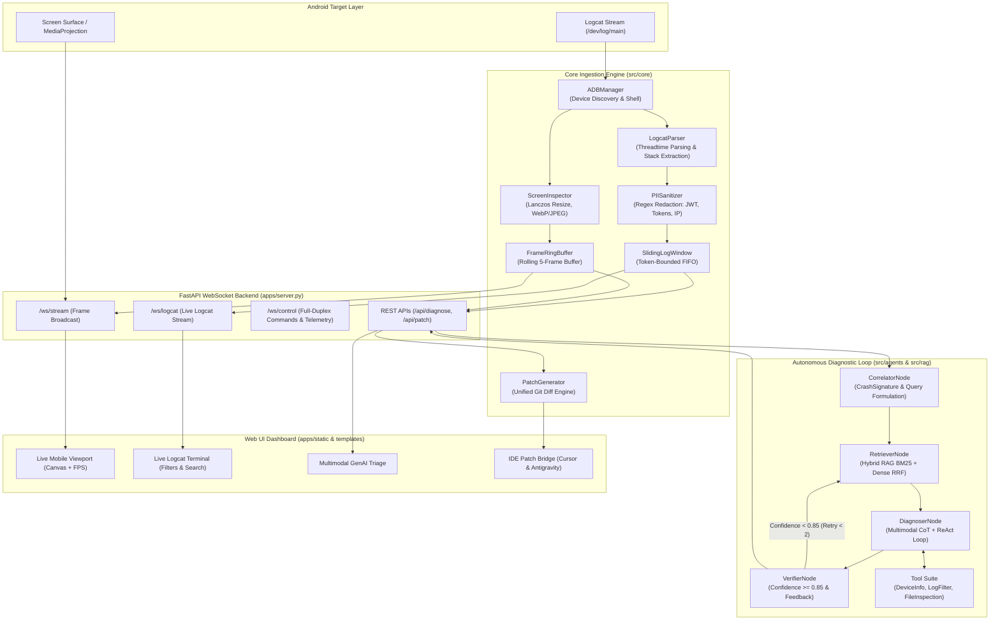

# GenAI Mobile App Debugger & Issue Analyzer

A production-grade, multimodal developer companion that bridges runtime mobile anomalies (crashes, ANRs, visual glitches, frozen compositions) directly to automated developer remediation in **Cursor Composer** and **Antigravity**.

**Author:** Arun Krishnan

---

## 🌟 Key Capabilities

- **Autonomous Multi-Agent Diagnostic Loop (LangGraph):** Cyclic ReAct StateGraph orchestrating fault triage through 4 specialized nodes (`CorrelatorNode` -> `RetrieverNode` -> `DiagnoserNode` -> `VerifierNode`), supported by a pure-Python zero-dependency fallback runner.
- **Self-Correcting Iterative Feedback Loop:** Dynamic verification gating ensuring only diagnoses with confidence $\ge 0.85$ are accepted; low-confidence analyses trigger actionable feedback injection and targeted retrieval refinements (bounded to 2 retries).
- **Native ReAct Tool Suite & Confinement:** Sandboxed execution of `DeviceInfoTool` (hardware/API specs), `LogFilterTool` (tag/level/thread slicing), and `FileInspectionTool` (source window extraction with strict directory traversal prevention).
- **Hybrid RAG Knowledge Retrieval:** Combines sparse BM25Okapi lexical matching with dense vector embeddings via Reciprocal Rank Fusion (RRF) to ground diagnoses in curated Android SDK architectural patterns.
- **Two-Way Live Screen Streaming:** Sub-100ms real-time screen streaming via WebSockets (`/ws/stream`) and HTML5 canvas with dynamic downsampling (Lanczos) and WebP/JPEG compression.
- **Live Logcat Correlation & PII Redaction:** High-throughput threadtime log ingestion with instant regex redaction of Bearer tokens, JWTs, emails, UUIDs, and IP addresses.
- **Automated IDE Patch Generation:** Synthesizes unified Git diffs and ready-to-paste action prompts for **Cursor Composer** (`@file`) and **Antigravity** specialist subagents (`ROLE: general-dev`).
- **Native Android Streaming Client:** Modern Kotlin app targeting Android 14 (API 34) using `MediaProjection`, foreground capture service, and OkHttp WebSocket streaming.
- **100% Offline Testability (59/59 Tests):** Full test suite executing deterministically in ~3s with zero external hardware or network dependencies.

---

## 🏛️ System Architecture



---

## 📁 Repository Structure

```text
GenAI tutorial/
├── android/                         # Native Android Streaming App (Kotlin / Compose)
│   ├── build.gradle.kts             # Root Gradle build script
│   ├── settings.gradle.kts          # Gradle project settings
│   └── app/                         # App module (API 34 / Android 14)
│       ├── build.gradle.kts         # Dependencies (OkHttp, Compose, Coroutines)
│       └── src/main/
│           ├── AndroidManifest.xml  # FOREGROUND_SERVICE_MEDIA_PROJECTION
│           └── java/com/genai/debugger/
│               ├── MainActivity.kt  # Capture consent & service controller
│               ├── network/         # OkHttp WebSocket streaming client
│               └── service/         # MediaProjection foreground capture service
│
├── apps/                            # Web Backend & Developer Dashboards
│   ├── server.py                    # FastAPI server & WebSocket hub
│   ├── templates/index.html         # Responsive two-pane debugging dashboard
│   ├── static/style.css             # Dark-themed dashboard styling
│   ├── static/app.js                # Frontend streaming & control logic
│   └── demo_app.py                  # Streamlit alternative interface
│
├── docs/                            # Architectural Guides & Specifications
│   └── FOUNDATIONS.md               # Exhaustive foundation & agent component guide
│
├── src/                             # Reusable Python Core Modules
│   ├── core/                        # Ingestion, parsing, data contracts, diff synthesis
│   │   ├── models.py                # Pydantic v2 schemas and enums
│   │   ├── adb_manager.py           # ADB process orchestration & mock mode
│   │   ├── logcat_parser.py         # LogcatParser, PIISanitizer, SlidingLogWindow
│   │   ├── screen_inspector.py      # ScreenInspector, FrameRingBuffer
│   │   ├── patch_generator.py       # Diff synthesis, Cursor & Antigravity formatters
│   │   ├── llm_client.py            # Multimodal client interface & mock provider
│   │   └── logger.py                # Centralized structured logging
│   ├── rag/                         # Retrieval-Augmented Generation components
│   │   ├── hybrid_retriever.py      # Sparse BM25 + Dense RRF fusion engine
│   │   └── vector_store.py          # Vector store & in-memory embeddings
│   ├── agents/                      # Autonomous Diagnostic Reasoning Loops
│   │   ├── diagnostic_agent.py      # LangGraph cyclic ReAct state graph & fallback runner
│   │   └── tools.py                 # DeviceInfoTool, LogFilterTool, FileInspectionTool, ToolRegistry
│   ├── prompts/                     # Prompt templates & system instructions
│   │   └── templates.py             # Staff Android engineer prompts
│   └── evaluation/                  # Benchmark scoring & metrics
│
├── tests/                           # Automated Verification Test Suite (59 Tests)
│   ├── test_agent_graph.py          # StateGraph nodes, ReAct tools, retry loop, API integration
│   ├── test_diagnoser.py            # Multimodal CoT reasoning & prompt synthesis
│   ├── test_foundations.py          # Models, ADB mock, log parsing, PII redaction, diffs
│   ├── test_retriever.py            # BM25 + Dense RRF retrieval & knowledge card scoring
│   └── test_text_gen.py             # Baseline prompt & tool tests
│
├── requirements.txt                 # Categorized Python dependencies
└── README.md                        # Project documentation
```

---

## 🚀 Quickstart Guide

### 1. Environment Setup

```bash
# Clone the repository
git clone https://github.com/h4xi0n/GenAI-MobileApp-Debugger-Issue-Analyzer.git
cd GenAI-MobileApp-Debugger-Issue-Analyzer

# Create and activate virtual environment
python -m venv venv

# Windows
.\venv\Scripts\Activate.ps1

# Linux / macOS
source venv/bin/activate

# Install dependencies
pip install -r requirements.txt
```

### 2. Launch the Web Streaming & Debugging Server

```bash
python apps/server.py
```

Open `http://localhost:8000` in your browser. The dashboard connects via WebSockets and begins streaming live logcat events and screen frames. If no physical device is connected, the server automatically starts in **Offline Mock Mode**, generating realistic UI state and crash traces for immediate testing.

---

## 📱 Connecting Android Physical Devices or Emulators

### Via ADB Reverse (Recommended for USB)
```bash
# Forward WebSocket port over USB
adb reverse tcp:8000 tcp:8000

# Verify device is detected
adb devices -l
```

### Via Native Streaming App
1. Open the `android/` project in Android Studio or build via CLI:
   ```bash
   cd android
   ./gradlew assembleDebug
   adb install -r app/build/outputs/apk/debug/app-debug.apk
   ```
2. Launch **GenAI Debugger** on your device.
3. Enter your host IP (or `10.0.2.2` if running in standard emulator) and tap **Start Live Screen Stream**.
4. Grant the `MediaProjection` consent dialog to begin streaming frames.

---

## 🛠️ Automated IDE Remediation Workflows

When an anomaly or fatal crash occurs, trigger diagnosis from the Web UI or via REST API:

```bash
curl -X POST http://localhost:8000/api/diagnose
```

### Cursor Composer Prompt
Copy the generated prompt directly into Cursor Composer (`Ctrl + I` / `Cmd + I`):
```markdown
### 🤖 Cursor Composer Action Prompt
**Target:** `@app/src/main/java/com/example/mobileapp/ui/FeedScreen.kt`

**Diagnosis:** java.lang.NullPointerException: Attempt to invoke virtual method on a null object reference
**Root Cause:** Fatal runtime crash in package 'com.example.mobileapp' at FeedScreen.kt:42.
...
```

### Antigravity Specialist Subagent Handoff
Copy the formatted task handoff into an Antigravity agent thread:
```markdown
### 🪐 Antigravity Specialist Subagent Handoff
ROLE: general-dev
TASK_ID: FIX-8942
FILES:
* app/src/main/java/com/example/mobileapp/ui/FeedScreen.kt
OBJECTIVE: Remediate NullPointerException in FeedScreen.kt (Report #RPT-8942)
...
DONE
```

---

## 🧪 Running Automated Tests

Run the complete test suite (59 passing tests) offline:

```bash
# Run all 59 tests across all suites
python -m pytest tests/ -v

# Run the LangGraph agent state machine & tool suite
python -m pytest tests/test_agent_graph.py -v

# Run foundation tests (models, ADB mock, log parsing, PII redaction, diffs)
python -m pytest tests/test_foundations.py -v

# Run Hybrid RAG retriever tests (BM25 + Dense RRF)
python -m pytest tests/test_retriever.py -v

# Run multimodal diagnoser tests
python -m pytest tests/test_diagnoser.py -v
```

All 59 tests execute completely offline without requiring physical hardware, live emulator connections, or external API keys:
- `test_agent_graph.py` (25 tests): StateGraph nodes (`CorrelatorNode`, `RetrieverNode`, `DiagnoserNode`, `VerifierNode`), ReAct tools (`DeviceInfoTool`, `LogFilterTool`, `FileInspectionTool`), path traversal security, self-correction retry bounding, pure-Python fallback StateGraph runner, and FastAPI `/api/diagnose` integration.
- `test_diagnoser.py` (10 tests): Multimodal CoT reasoning, prompt templates, and schema verification.
- `test_foundations.py` (14 tests): Data contracts, ADB process orchestration, threadtime parsing, PII scrubbing, screen downsampling, ring buffer rotation, and Git diff synthesis.
- `test_retriever.py` (8 tests): BM25 lexical search, dense embeddings, Reciprocal Rank Fusion (RRF), and knowledge card retrieval.
- `test_text_gen.py` (2 tests): Baseline prompt & tool execution sanity checks.

---

## 🗺️ 1-Month Accelerated GenAI Mastery Roadmap

This companion system is developed as the practical portfolio capstone supporting author Arun Krishnan's transition from Senior Android Engineer to GenAI Product Engineer. See [ROADMAP_1MONTH_SENIOR.md](ROADMAP_1MONTH_SENIOR.md) for the structured 4-week curriculum:

- **Week 1: Core Multimodal LLM Foundations & Ingestion Pipeline** (Completed)
  - Android MediaProjection streaming & ADB shell orchestration.
  - Multi-provider VLM Gateway (Gemini 2.0 Flash / Claude 3.5 Sonnet / GPT-4o) with 5-step Chain-of-Thought prompts.
- **Week 2: Advanced Hybrid RAG & Vector Search** (Completed)
  - Sparse BM25Okapi + Dense vector embeddings fused with Reciprocal Rank Fusion ($k=60$).
  - Curated Android SDK knowledge base grounded in Compose, Media3, and Coroutine concurrency traps.
- **Week 3: Autonomous Multi-Agent Systems & LangGraph** (Completed)
  - Cyclic ReAct StateGraph (`CorrelatorNode` $\to$ `RetrieverNode` $\to$ `DiagnoserNode` $\to$ `VerifierNode`).
  - Native sandboxed tool suite (`DeviceInfoTool`, `LogFilterTool`, `FileInspectionTool`).
  - Iterative self-correction feedback loop (confidence $\ge 0.85$, bounded to 2 retries).
- **Week 4: IDE Remediation & Production Deployment** (In Progress)
  - Cursor Composer action prompts & Antigravity MAS specialist handoffs.
  - High-concurrency FastAPI serving with WebSocket telemetry.

---

## 🔒 Privacy & Compliance

This repository strictly complies with anonymization standards. All author references are attributed exclusively to **Arun Krishnan**, and all personal background information (educational institutions, prior employers, locations, personal hardware) is excluded.
