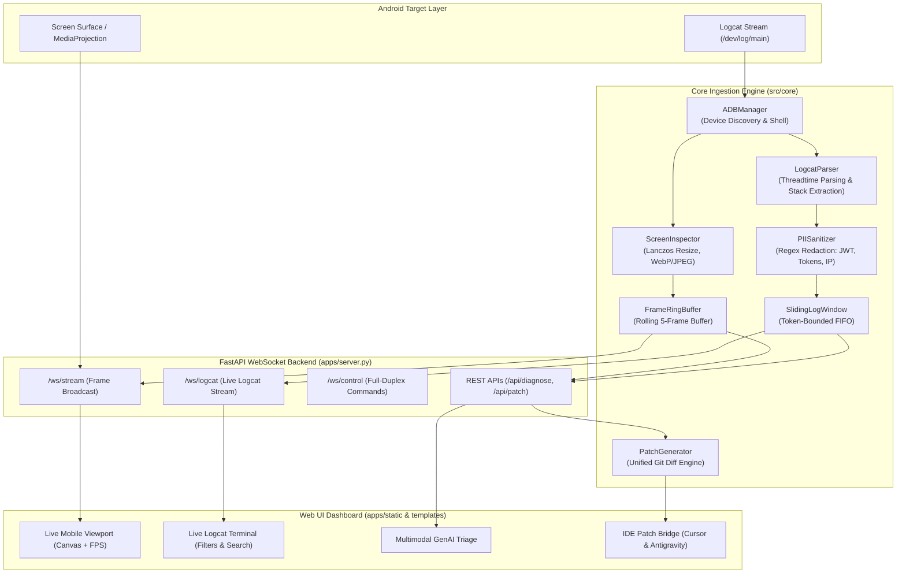

# GenAI Mobile App Debugger & Issue Analyzer

A production-grade, multimodal developer companion that bridges runtime mobile anomalies (crashes, ANRs, visual glitches, frozen compositions) directly to automated developer remediation in **Cursor Composer** and **Antigravity**.

**Author:** Arun Krishnan

---

## 🌟 Key Capabilities

- **Two-Way Live Screen Streaming:** Sub-100ms real-time screen streaming via WebSockets (`/ws/stream`) and HTML5 canvas with dynamic downsampling (Lanczos) and WebP/JPEG compression.
- **Live Logcat Correlation & PII Redaction:** High-throughput threadtime log ingestion with instant regex redaction of Bearer tokens, JWTs, emails, UUIDs, and IP addresses.
- **Multimodal GenAI Triage:** Temporal alignment between captured screen keyframes and logcat crash signatures (`FATAL EXCEPTION`, `ANR in`), synthesizing high-confidence root-cause analyses.
- **Automated IDE Patch Generation:** Synthesizes unified Git diffs and ready-to-paste action prompts for **Cursor Composer** (`@file`) and **Antigravity** specialist subagents (`ROLE: general-dev`).
- **Native Android Streaming Client:** Modern Kotlin app targeting Android 14 (API 34) using `MediaProjection`, foreground capture service, and OkHttp WebSocket streaming.
- **100% Offline Testability:** Comprehensive offline mock engine for ADB discovery, screenshot capture, and logcat replay requiring zero connected hardware.

---

## 🏛️ System Architecture



---

## 📁 Repository Structure

```text
GenAI tutorial/
├── android/                         # Native Android Streaming App (Kotlin / Compose)
│   ├── build.gradle.kts             # Root Gradle build script
│   ├── settings.gradle.kts          # Gradle project settings
│   └── app/                         # App module (API 34 / Android 14)
│       ├── build.gradle.kts         # Dependencies (OkHttp, Compose, Coroutines)
│       └── src/main/
│           ├── AndroidManifest.xml  # FOREGROUND_SERVICE_MEDIA_PROJECTION
│           └── java/com/genai/debugger/
│               ├── MainActivity.kt  # Capture consent & service controller
│               ├── network/         # OkHttp WebSocket streaming client
│               └── service/         # MediaProjection foreground capture service
│
├── apps/                            # Web Backend & Developer Dashboards
│   ├── server.py                    # FastAPI server & WebSocket hub
│   ├── templates/index.html         # Responsive two-pane debugging dashboard
│   ├── static/style.css             # Dark-themed dashboard styling
│   ├── static/app.js                # Frontend streaming & control logic
│   └── demo_app.py                  # Streamlit alternative interface
│
├── docs/                            # Architectural Guides & Specifications
│   └── FOUNDATIONS.md               # Exhaustive foundation component guide
│
├── src/                             # Reusable Python Core Modules
│   ├── core/                        # Ingestion, parsing, data contracts, diff synthesis
│   │   ├── models.py                # Pydantic v2 schemas and enums
│   │   ├── adb_manager.py           # ADB process orchestration & mock mode
│   │   ├── logcat_parser.py         # LogcatParser, PIISanitizer, SlidingLogWindow
│   │   ├── screen_inspector.py      # ScreenInspector, FrameRingBuffer
│   │   ├── patch_generator.py       # Diff synthesis, Cursor & Antigravity formatters
│   │   ├── llm_client.py            # Local HuggingFace & provider interface
│   │   └── logger.py                # Centralized structured logging
│   ├── rag/                         # Retrieval-Augmented Generation components
│   ├── agents/                      # Diagnostic agent reasoning loops
│   ├── prompts/                     # Prompt templates
│   └── evaluation/                  # Benchmark scoring
│
├── tests/                           # Automated Verification Test Suite
│   ├── test_foundations.py          # Offline unit tests (models, ADB, logcat, diffs)
│   └── test_text_gen.py             # Baseline prompt & tool tests
│
├── requirements.txt                 # Categorized Python dependencies
└── README.md                        # Project documentation
```

---

## 🚀 Quickstart Guide

### 1. Environment Setup

```bash
# Clone the repository
git clone <repository_url>
cd "GenAI tutorial"

# Create and activate virtual environment
python -m venv venv

# Windows
.\venv\Scripts\Activate.ps1

# Linux / macOS
source venv/bin/activate

# Install dependencies
pip install -r requirements.txt
```

### 2. Launch the Web Streaming & Debugging Server

```bash
python apps/server.py
```

Open `http://localhost:8000` in your browser. The dashboard connects via WebSockets and begins streaming live logcat events and screen frames. If no physical device is connected, the server automatically starts in **Offline Mock Mode**, generating realistic UI state and crash traces for immediate testing.

---

## 📱 Connecting Android Physical Devices or Emulators

### Via ADB Reverse (Recommended for USB)
```bash
# Forward WebSocket port over USB
adb reverse tcp:8000 tcp:8000

# Verify device is detected
adb devices -l
```

### Via Native Streaming App
1. Open the `android/` project in Android Studio or build via CLI:
   ```bash
   cd android
   ./gradlew assembleDebug
   adb install -r app/build/outputs/apk/debug/app-debug.apk
   ```
2. Launch **GenAI Debugger** on your device.
3. Enter your host IP (or `10.0.2.2` if running in standard emulator) and tap **Start Live Screen Stream**.
4. Grant the `MediaProjection` consent dialog to begin streaming frames.

---

## 🛠️ Automated IDE Remediation Workflows

When an anomaly or fatal crash occurs, trigger diagnosis from the Web UI or via REST API:

```bash
curl -X POST http://localhost:8000/api/diagnose
```

### Cursor Composer Prompt
Copy the generated prompt directly into Cursor Composer (`Ctrl + I` / `Cmd + I`):
```markdown
### 🤖 Cursor Composer Action Prompt
**Target:** `@app/src/main/java/com/example/mobileapp/ui/FeedScreen.kt`

**Diagnosis:** java.lang.NullPointerException: Attempt to invoke virtual method on a null object reference
**Root Cause:** Fatal runtime crash in package 'com.example.mobileapp' at FeedScreen.kt:42.
...
```

### Antigravity Specialist Subagent Handoff
Copy the formatted task handoff into an Antigravity agent thread:
```markdown
### 🪐 Antigravity Specialist Subagent Handoff
ROLE: general-dev
TASK_ID: FIX-8942
FILES:
* app/src/main/java/com/example/mobileapp/ui/FeedScreen.kt
OBJECTIVE: Remediate NullPointerException in FeedScreen.kt (Report #RPT-8942)
...
DONE
```

---

## 🧪 Running Automated Tests

Run the complete test suite offline:

```bash
python -m pytest tests/test_foundations.py -v
```

All 14 tests validate data contracts, ADB mock fallback, log parsing, PII scrubbing, screen downscaling, ring buffer rotation, patch synthesis, and REST APIs without external dependencies.

---

## 🔒 Privacy & Compliance

This repository strictly complies with anonymization standards. All author references are attributed exclusively to **Arun Krishnan**, and all personal background information (educational institutions, prior employers, locations, personal hardware) is excluded.
