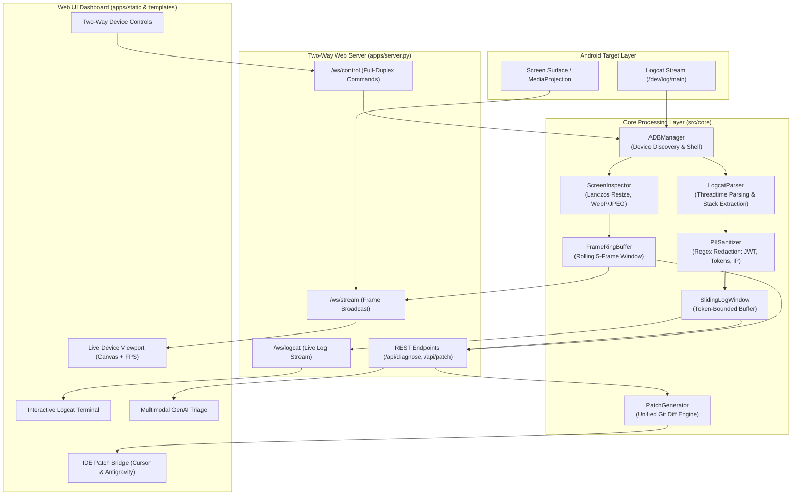
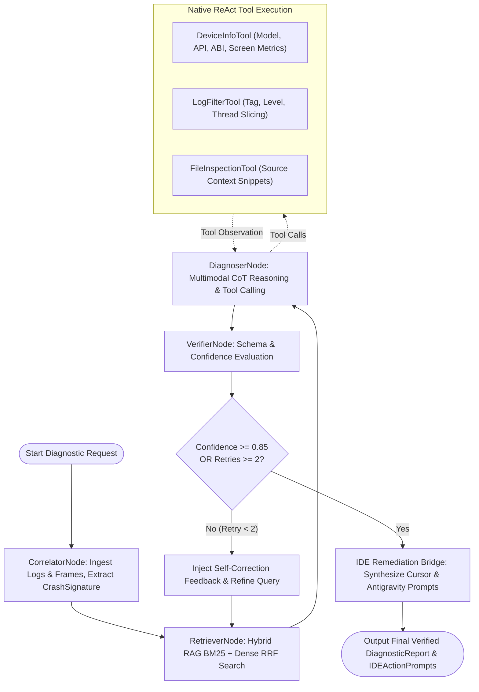

# Architectural Foundations Guide

## GenAI Mobile App Debugger & Issue Analyzer

**Author:** Arun Krishnan  
**Platform Scope:** Android (Kotlin, Jetpack Compose, MediaProjection) + Python (FastAPI, WebSockets, Pydantic v2, Pillow) + AI Developer Tooling (Cursor Composer, Antigravity MAS).

---

## 1. System Overview & Architectural Blueprint

The **GenAI Mobile App Debugger & Issue Analyzer** is an end-to-end platform bridging runtime mobile device anomalies (crashes, ANRs, visual glitches, frozen state) directly to automated developer remediation.

Mobile debugging fundamentally relies on two complementary data channels:
1. **Visual UI Telemetry:** Live frame captures of what is rendered on screen (crash dialogs, ANR dialogs, empty states, frozen compositions).
2. **Runtime Log Telemetry:** High-throughput `logcat` streams containing system events, lifecycle transitions, warning markers, and exception stack traces.

The platform continuously streams and buffers both sensory streams, scrubs sensitive information via a compiled PII redaction engine, correlates anomalous screen states with logcat stack traces, and synthesizes actionable remediation diffs for **Cursor Composer** and **Antigravity** specialist subagents.



---

## 2. In-Depth Component Breakdown

### 2.1 Data Contracts & Domain Models (`src/core/models.py`)

Every layer communicates through strict, validated **Pydantic v2** models, eliminating implicit dictionary parsing and ensuring runtime type safety.

- **`LogLevel`**: Android severity enum (`VERBOSE`, `DEBUG`, `INFO`, `WARN`, `ERROR`, `FATAL`).
- **`LogEntry`**: Represents a single threadtime log line. Trims tags, isolates exception traces, and sanitizes payloads.
- **`ScreenState`**: Enum tracking visual anomalies (`NORMAL`, `CRASH_DIALOG`, `ANR_DIALOG`, `BLANK_SCREEN`, `FROZEN_UI`, `LAYOUT_GLITCH`).
- **`ScreenFrame`**: Encapsulates compressed image base64, mime type (`image/webp` or `image/jpeg`), resolution, frame UUID, and timestamp.
- **`CrashSignature`**: Structured crash metadata isolating exception type (`java.lang.NullPointerException`), package name, offending file, line number, and raw stack trace.
- **`DiagnosticReport`**: Multimodal diagnosis contract with confidence rating (0.0–1.0), root cause analysis, affected components, and remediation suggestions.
- **`IDEActionPrompt`**: Remediation output formatted for target IDEs (`cursor` or `antigravity`), complete with target files and unified diffs.
- **`DeviceCommand` & `DeviceStatus`**: Control protocol messages managing two-way communication.

---

### 2.2 ADB Manager & Subprocess Engine (`src/core/adb_manager.py`)

The ADB Manager orchestrates physical devices and emulators over USB or TCP.

- **Device Discovery (`list_devices`)**: Parses `adb devices -l` to track serials, model names, and connection states.
- **Subprocess Logcat Streaming (`stream_logcat_lines`)**: Spawns an asynchronous generator reading `adb logcat -v threadtime` with non-blocking readline and graceful shutdown.
- **Screen Capture (`capture_screenshot`)**: Runs `adb exec-out screencap -p` returning raw PNG bytes.
- **Lifecycle & Inspection**: Provides package launch (`am start`), force-stop (`am force-stop`), data wipe (`pm clear`), and port reversal (`adb reverse tcp:8000 tcp:8000`).
- **Offline Mock Fallback**: When no device is attached or in CI environments, `ADBManager` operates in mock mode, producing synthetic 720x1280 screen frames and realistic logcat traces.

---

### 2.3 Logcat Parser, Exception Isolator & PII Sanitizer (`src/core/logcat_parser.py`)

- **`LogcatParser`**: Uses regex `^(\d{2}-\d{2}\s+\d{2}:\d{2}:\d{2}\.\d{3})\s+(\d+)\s+(\d+)\s+([VDIWEF])\s+([^:]+):\s*(.*)$` to parse threadtime logs into structured `LogEntry` records. Detects continuation stack lines (`\tat `, `Caused by:`, `AndroidRuntime`).
- **`PIISanitizer`**: Pre-filtering security gateway executing compiled regex replacements before logs reach the Web UI or LLM prompts:
  - Authorization / Bearer tokens: `(?i)bearer\s+[a-zA-Z0-9_\-\.]+` $\rightarrow$ `Bearer [REDACTED_TOKEN]`
  - JWT strings: `eyJ[a-zA-Z0-9_\-]+\.eyJ[a-zA-Z0-9_\-]+\.[a-zA-Z0-9_\-]+` $\rightarrow$ `[REDACTED_JWT]`
  - Email addresses: `[a-zA-Z0-9_.+-]+@[a-zA-Z0-9-]+\.[a-zA-Z0-9-.]+` $\rightarrow$ `[REDACTED_EMAIL]`
  - UUIDs: `\b[0-9a-fA-F]{8}-[0-9a-fA-F]{4}-[0-9a-fA-F]{4}-[0-9a-fA-F]{4}-[0-9a-fA-F]{12}\b` $\rightarrow$ `[REDACTED_UUID]`
  - Non-loopback IPv4 addresses $\rightarrow$ `[REDACTED_IP]`
- **`SlidingLogWindow`**: Bounded in-memory FIFO buffer retaining up to 300 lines with an approximate token ceiling (4,000 tokens), allowing level-filtered retrieval.

---

### 2.4 Screen Inspector & Frame Ring Buffer (`src/core/screen_inspector.py`)

Screen captures can be large ($1080 \times 2400+$ at ~5 MB uncompressed PNG), which rapidly consumes bandwidth and LLM token budgets.

- **Lanczos Downsampling**: Scales the image down proportionally so that neither width nor height exceeds 1024px.
- **Compression**: Re-encodes frames to WebP (quality 80) or JPEG, reducing typical payload size from 5 MB to ~80–120 KB.
- **`FrameRingBuffer`**: Thread-safe rolling ring buffer holding the most recent 5 frames. When a crash or manual trigger occurs, the ring buffer yields a deterministic multi-frame sequence leading up to the failure.

---

### 2.5 IDE Patch & Action Prompt Bridge (`src/core/patch_generator.py`)

Bridges the diagnostic report into directly usable developer prompts.

- **Unified Diff Synthesis**: Uses Python `difflib.unified_diff` to produce standard Git `--- a/file` and `+++ b/file` patches.
- **Cursor Composer Formatter**: Outputs Markdown prompts referencing target files (`@FeedScreen.kt`), root causes, and diff code blocks.
- **Antigravity Formatter**: Outputs standard Multi-Agent System (MAS) task specifications (`ROLE: general-dev`, `TASK_ID`, `FILES:`, `DIFF:`, `DONE`).

---

### 2.6 FastAPI Web Backend & Two-Way WebSockets (`apps/server.py`)

- **WebSocket `/ws/stream`**: Bidirectional frame pipeline. Receives frames from Android clients or requests frames via ADB, and broadcasts frames to connected web browsers at up to 15 FPS.
- **WebSocket `/ws/logcat`**: Broadcasts parsed, PII-sanitized logcat lines to browser sessions in real-time.
- **WebSocket `/ws/control`**: Full-duplex command channel supporting actions:
  - `REQUEST_KEYFRAME`: Forces immediate high-res capture.
  - `SET_FPS`: Throttles device capture frame rate.
  - `RESTART_PACKAGE`: Restarts the target Android app via ADB.
  - `CLEAR_LOGCAT`: Clears device and server buffers.
- **REST Endpoints**:
  - `GET /api/health`: Server health and buffer statistics.
  - `GET /api/devices`: List of connected Android devices.
  - `POST /api/diagnose`: Triggers multimodal analysis on current buffer state.
  - `POST /api/patch`: Generates IDE prompt actions for a report.

---

### 2.7 Native Android Streaming App Foundation (`android/`)

The native Android app under `android/` implements a production-grade frame capture pipeline:

- **Target SDK 34 / Android 14 Compliance**: Declares `FOREGROUND_SERVICE_MEDIA_PROJECTION` in `AndroidManifest.xml` and runs `MediaProjectionService` with ongoing system notifications.
- **`MediaProjectionService.kt`**: Obtains `MediaProjection` token from user consent, creates a `VirtualDisplay` mirroring into an `ImageReader` (RGBA_8888), compresses frames to JPEG/WebP, and transmits them over WebSockets.
- **`WebSocketStreamClient.kt`**: Resilient OkHttp client with ping heartbeats, auto-reconnect, and bi-directional command processing (`SET_FPS`, `REQUEST_KEYFRAME`).
- **`MainActivity.kt`**: Jetpack Compose interface allowing the developer to configure the server host/port and toggle live streaming.

---

### 2.8 Hybrid RAG Knowledge Engine & Vector Search (`src/rag/hybrid_retriever.py`)

Grounded Android SDK debugging requires balancing exact lexical identifiers (class names, exception strings, method signatures) with semantic architectural concepts (lifecycle races, coroutine cancellation, recomposition loops).

- **BM25 Lexical Index**: Tokenizes exception messages, stack traces, and API names with BM25Okapi scoring.
- **Dense Vector Search**: Embeds crash semantics using sentence-transformers / ChromaDB embeddings.
- **Reciprocal Rank Fusion (RRF)**: Merges sparse and dense ranked lists with constant $k=60$:
  $$RRF\_Score(d) = \sum_{m \in M} \frac{1}{k + r_m(d)}$$
- **Curated Android Knowledge Cards**: In-memory domain cards covering Jetpack Compose state hoisting, Activity/Fragment lifecycles, CoroutineExceptionHandler, OkHttp timeouts, and MediaProjection security.

---

### 2.9 Autonomous Multi-Agent Diagnostic Loop with LangGraph (`src/agents/diagnostic_agent.py`)

The Week 3 milestone elevates the system from static linear analysis to an autonomous, multi-agent cyclic ReAct state graph built on LangGraph (with pure-Python deterministic fallback).



#### 2.9.1 Strongly Typed Diagnostic State (`DiagnosticState`)
A centralized `TypedDict` schema passed and modified across graph nodes:
- `package_name`: Target application package identifier.
- `log_entries`: Ingested sliding logcat window.
- `screen_frame`: Latest captured device frame (WebP/JPEG Base64).
- `crash_signature`: Isolated fatal exception type, file, line, and stack trace.
- `screen_state`: Categorized visual state (`NORMAL`, `CRASH_DIALOG`, `ANR_DIALOG`, `BLANK_SCREEN`).
- `device_meta`: Device hardware and OS details from ADB/mock.
- `grounding_cards`: Top-k Android SDK architectural cards from HybridRetriever.
- `tool_history`: Immutable ledger of executed tools, arguments, and returned observations.
- `report`: Synthesized Pydantic v2 `DiagnosticReport`.
- `verification_feedback`: Actionable critique generated by VerifierNode during self-correction.
- `retry_count` & `max_retries`: Bounded loop counters (default max 2 retries).
- `confidence_score` & `is_verified`: Quality metrics evaluated by VerifierNode.
- `ide_prompts`: Generated action prompts for Cursor Composer and Antigravity.

#### 2.9.2 StateGraph Node Lifecycle
1. **`CorrelatorNode`**: Ingests raw `log_entries` and viewport `screen_frame`, invokes `LogcatParser.extract_crash_signature()` to isolate fatal exceptions (`FATAL EXCEPTION`, `ANR in`), correlates visual dialog anomalies with timestamped log events, and formulates initial retrieval queries.
2. **`RetrieverNode`**: Executes hybrid BM25 + dense search against the Android SDK knowledge base via `HybridRetriever`. If entering a self-correction loop, refines queries using `verification_feedback`.
3. **`DiagnoserNode`**: Performs multimodal Chain-of-Thought (CoT) reasoning combining system prompt (`STAFF_ANDROID_SYSTEM_PROMPT`), logcat trace, image frame, grounding cards, and tool observation history. Executes an iterative ReAct tool-calling loop (up to 3 iterations), calling tools via `ToolRegistry` and integrating observations before finalizing `DiagnosticReport`.
4. **`VerifierNode`**: Validates report schema integrity, assesses logical alignment between identified root causes and stack traces, and evaluates confidence against the `confidence_threshold` (0.85):
   - **Confidence $\ge 0.85$**: Sets `is_verified = True`, generates `ide_prompts`, and terminates at `END`.
   - **Confidence $< 0.85$ and `retry_count < max_retries`**: Increments `retry_count`, drafts specific `verification_feedback`, and routes back to `RetrieverNode` / `DiagnoserNode` for self-correction.
   - **`retry_count >= max_retries`**: Halts retry loop, preserves partial diagnosis, sets `is_verified = False`, generates available prompts, and routes to `END`.

#### 2.9.3 Zero-Dependency Fallback Runner (`FallbackStateGraph`)
To ensure resilient, hermetic execution in air-gapped or CI environments lacking the external `langgraph` package, `src/agents/diagnostic_agent.py` includes a deterministic pure-Python runner (`FallbackStateGraph` & `CompiledStateGraph`) providing the identical API (`add_node`, `set_entry_point`, `add_edge`, `add_conditional_edges`, `compile`, `ainvoke`, `invoke`).

---

### 2.10 Native ReAct Tool Suite & Security Confinement (`src/agents/tools.py`)

Provides specialized, callable tools enabling autonomous inspection during diagnostic reasoning:

1. **`DeviceInfoTool`**: Interrogates connected hardware or mock ADB fallback to return model, manufacturer, Android SDK API level, ABI architecture, battery state, and display metrics.
2. **`LogFilterTool`**: Performs high-performance in-memory slicing of logcat entries by tag (e.g., `AndroidRuntime`), severity level (`LogLevel.ERROR`, `LogLevel.FATAL`), thread ID (`tid`), process ID (`pid`), or compiled regex patterns.
3. **`FileInspectionTool`**: Reads source code snippets around crashing lines (`file_path:line_number`) with explicit line windowing.
   - **Strict Confinement & Security**: Enforces path normalization and strict directory boundary checking (`target.relative_to(workspace_root)`). Explicitly blocks directory traversal attempts (`..`), absolute root path escapes, and non-UTF-8 binary files.
4. **`ToolRegistry`**: Manages tool registration, dynamic dispatch with exception isolation, and LLM-ready JSON Schema generation (`to_schema()` conforming to OpenAI/Anthropic/Gemini function-calling formats).

---

### 2.11 IDE Remediation Bridge & Multi-Agent Handoffs (`src/core/patch_generator.py`)

Transforms verified diagnostic output into actionable developer remediation artifacts:

- **Cursor Composer Formatter (`format_cursor_prompt`)**: Outputs targeted markdown referencing workspace files (`@FeedScreen.kt`), root-cause summaries, stack traces, and unified diff blocks for single-keystroke developer execution.
- **Antigravity Specialist Handoff (`format_antigravity_handoff`)**: Synthesizes standard Multi-Agent System (MAS) handoffs (`ROLE: general-dev`, `TASK_ID`, `FILES:`, `OBJECTIVE:`, `DIFF:`, `DONE`) for autonomous agent delegation.

---

## 3. Quickstart & Verification Walkthrough

### 3.1 Running the Python Server & Web Dashboard

```bash
# 1. Install dependencies
pip install -r requirements.txt

# 2. Launch FastAPI server
python apps/server.py
```
Open `http://localhost:8000` in any web browser to view the live dashboard.

### 3.2 Running the Full Offline Test Suite

The entire platform is backed by a 100% offline verification suite spanning foundation models, RAG retrieval, multimodal reasoning, tool security, and cyclic LangGraph state machines:

```bash
# Execute complete test suite (59 tests passing)
python -m pytest tests/ -v

# Execute LangGraph agent state machine suite
python -m pytest tests/test_agent_graph.py -v

# Execute foundation tests
python -m pytest tests/test_foundations.py -v

# Execute RAG hybrid retriever tests
python -m pytest tests/test_retriever.py -v
```

All 59 test cases execute deterministically in ~3 seconds without requiring external API keys, network access, or physical Android hardware.
